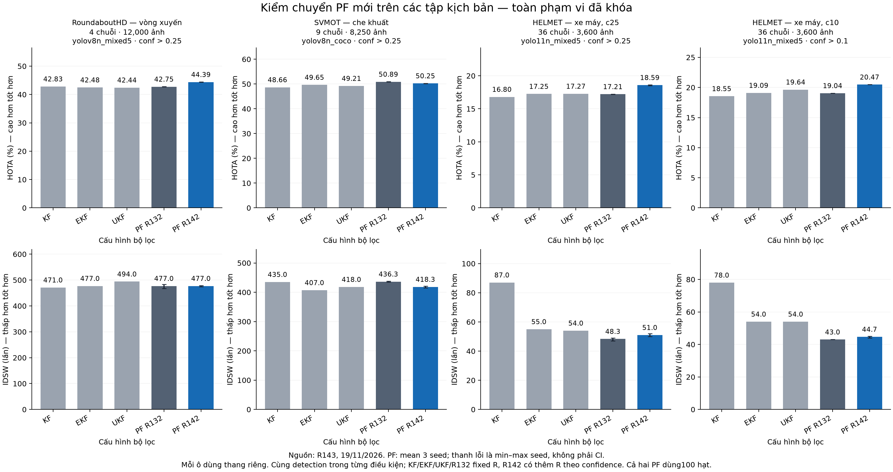
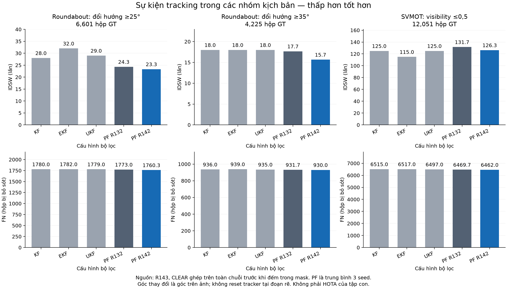

# R143 — kết quả PF mới trên ba tập kịch bản

Hoàn tất ngày 19/11/2026: 49 chuỗi khác nhau, bốn điều kiện (HELMET có hai ngưỡng), đủ 765 lượt chạy/36 nhóm. Cùng detection giữa các bộ lọc trong mỗi điều kiện. PF chạy ba seed 0/1/2. Không chỉnh lại R142 theo điểm mới. Các bộ lọc deterministic được chạy mới và raw từng video khớp lịch sử.

PF mới là Native Cartesian RBPF100 R142: chỉ lấy mẫu vận tốc góc, các trạng thái còn lại cập nhật Gaussian có điều kiện; chuyển score detection đang ghép vào `R(c)=max(1-c,0.05)R0`. PF đối chứng là cùng lõi R132, không dùng score để đổi R. Cột PF R132 ở đây không phải PF cổ điển500 hạt trong slide cũ.

## Kết quả chính

- **RoundaboutHD — vòng xuyến:** PF 477.00 IDSW so KF/EKF/UKF 471/477/494; chưa ít IDSW hơn cả ba mốc. HOTA PF 44.3868%. IDSW trung bình bằng cùng PF R132.

- **SVMOT — che khuất:** PF 418.33 IDSW so KF/EKF/UKF 435/407/418; chưa ít IDSW hơn cả ba mốc. HOTA PF 50.2462%. HOTA giảm 0.6424 điểm phần trăm so cùng PF R132.

- **HELMET — xe máy, c25:** PF 51.00 IDSW so KF/EKF/UKF 87/55/54; ít IDSW hơn cả ba mốc. HOTA PF 18.5916%. Nhiều hơn PF R132 trung bình 2.67 lượt đổi ID.

- **HELMET — xe máy, c10:** PF 44.67 IDSW so KF/EKF/UKF 78/54/54; ít IDSW hơn cả ba mốc. HOTA PF 20.4700%. Nhiều hơn PF R132 trung bình 1.67 lượt đổi ID.

## Điểm toàn phạm vi đã khóa

### RoundaboutHD — vòng xuyến

4 chuỗi, 12,000 ảnh mỗi lượt. Cấu hình nguồn: `r64_roundabout_yolov8n_mixed5_c0.05`; conf>0.25.

- **KF:** IDSW **471.00**, HOTA **42.8318%**, IDF1 55.3285%, FN 32,950.00, FP 9,307.00.

- **EKF:** IDSW **477.00**, HOTA **42.4829%**, IDF1 54.5688%, FN 32,969.00, FP 9,286.00.

- **UKF:** IDSW **494.00**, HOTA **42.4429%**, IDF1 54.5863%, FN 33,010.00, FP 9,330.00.

- **PF100 fixed R (R132):** IDSW **477.00**, HOTA **42.7536%**, IDF1 55.1582%, FN 32,960.00, FP 9,350.00.

- **PF100 R(confidence) (R142):** IDSW **477.00**, HOTA **44.3868%**, IDF1 56.0364%, FN 32,466.33, FP 8,921.00.

IDSW R142 từng seed: [478, 474, 479]. Kiểm mô tả: `{'IDSW_below_all': False, 'HOTA_vs_parent': True, 'FN_vs_parent': True}`. Không biến kiểm mô tả thành lý do loại bỏ điều kiện hoặc sửa tham số.

### SVMOT — che khuất

9 chuỗi, 8,250 ảnh mỗi lượt. Cấu hình nguồn: `r64_svmot_yolov8n_coco_c0.05`; conf>0.25.

- **KF:** IDSW **435.00**, HOTA **48.6604%**, IDF1 50.3009%, FN 14,665.00, FP 21,964.00.

- **EKF:** IDSW **407.00**, HOTA **49.6491%**, IDF1 51.9081%, FN 14,668.00, FP 22,043.00.

- **UKF:** IDSW **418.00**, HOTA **49.2095%**, IDF1 51.1808%, FN 14,672.00, FP 22,061.00.

- **PF100 fixed R (R132):** IDSW **436.33**, HOTA **50.8886%**, IDF1 53.5397%, FN 14,610.67, FP 22,224.00.

- **PF100 R(confidence) (R142):** IDSW **418.33**, HOTA **50.2462%**, IDF1 52.4576%, FN 14,499.33, FP 22,124.33.

IDSW R142 từng seed: [421, 415, 419]. Kiểm mô tả: `{'IDSW_below_all': False, 'HOTA_vs_parent': False, 'FN_vs_parent': True}`. Không biến kiểm mô tả thành lý do loại bỏ điều kiện hoặc sửa tham số.

### HELMET — xe máy, c25

36 chuỗi, 3,600 ảnh mỗi lượt. Cấu hình nguồn: `r66_helmet_test36_6336582ee9b2_yolo11n_mixed5_c005`; conf>0.25.

- **KF:** IDSW **87.00**, HOTA **16.8045%**, IDF1 19.3108%, FN 8,120.00, FP 667.00.

- **EKF:** IDSW **55.00**, HOTA **17.2513%**, IDF1 19.9894%, FN 8,121.00, FP 685.00.

- **UKF:** IDSW **54.00**, HOTA **17.2719%**, IDF1 19.7824%, FN 8,131.00, FP 692.00.

- **PF100 fixed R (R132):** IDSW **48.33**, HOTA **17.2142%**, IDF1 19.8146%, FN 8,115.67, FP 665.00.

- **PF100 R(confidence) (R142):** IDSW **51.00**, HOTA **18.5916%**, IDF1 21.1233%, FN 8,062.33, FP 638.00.

IDSW R142 từng seed: [50, 51, 52]. Kiểm mô tả: `{'IDSW_below_all': True, 'HOTA_vs_parent': True, 'FN_vs_parent': True}`. Không biến kiểm mô tả thành lý do loại bỏ điều kiện hoặc sửa tham số.

### HELMET — xe máy, c10

36 chuỗi, 3,600 ảnh mỗi lượt. Cấu hình nguồn: `r66_helmet_test36_6336582ee9b2_yolo11n_mixed5_c005`; conf>0.1.

- **KF:** IDSW **78.00**, HOTA **18.5478%**, IDF1 21.7065%, FN 7,946.00, FP 795.00.

- **EKF:** IDSW **54.00**, HOTA **19.0936%**, IDF1 22.3615%, FN 7,915.00, FP 818.00.

- **UKF:** IDSW **54.00**, HOTA **19.6446%**, IDF1 22.4277%, FN 7,916.00, FP 856.00.

- **PF100 fixed R (R132):** IDSW **43.00**, HOTA **19.0445%**, IDF1 22.2617%, FN 7,908.67, FP 795.00.

- **PF100 R(confidence) (R142):** IDSW **44.67**, HOTA **20.4700%**, IDF1 23.7557%, FN 7,862.33, FP 766.67.

IDSW R142 từng seed: [45, 45, 44]. Kiểm mô tả: `{'IDSW_below_all': True, 'HOTA_vs_parent': True, 'FN_vs_parent': True}`. Không biến kiểm mô tả thành lý do loại bỏ điều kiện hoặc sửa tham số.

## Nhóm rẽ và nhóm che khuất

CLEAR được ghép trên toàn chuỗi; xác nhận tổng IDSW/FN khớp117 lượt trước khi đếm sự kiện trong nhóm. Không reset tracker ở đầu đoạn rẽ; không coi HOTA toàn tập là HOTA của riêng nhóm rẽ.

**Đổi hướng ảnh≥25°:** 6,601 hộp GT.

- KF: IDSW **28.00**, FN **1780.00**.

- EKF: IDSW **32.00**, FN **1782.00**.

- UKF: IDSW **29.00**, FN **1779.00**.

- PF100 fixed R (R132): IDSW **24.33**, FN **1773.00**.

- PF100 R(confidence) (R142): IDSW **23.33**, FN **1760.33**.

**Đổi hướng ảnh≥35°:** 4,225 hộp GT.

- KF: IDSW **18.00**, FN **936.00**.

- EKF: IDSW **18.00**, FN **939.00**.

- UKF: IDSW **18.00**, FN **935.00**.

- PF100 fixed R (R132): IDSW **17.67**, FN **931.67**.

- PF100 R(confidence) (R142): IDSW **15.67**, FN **930.00**.

**Độ nhìn thấy native≤0,5:** 12,051 hộp GT.

- KF: IDSW **125.00**, FN **6515.00**.

- EKF: IDSW **115.00**, FN **6517.00**.

- UKF: IDSW **125.00**, FN **6497.00**.

- PF100 fixed R (R132): IDSW **131.67**, FN **6469.67**.

- PF100 R(confidence) (R142): IDSW **126.33**, FN **6462.00**.

## Độ biến thiên HELMET

**HELMET — xe máy, c25**, bootstrap5.000 mẫu theo12 nhóm cảnh, lấy lại cả3 clip của nhóm:

- R142−KF: IDSW -36.00, CI95% [-91.00833333333333, -3.0]; HOTA +1.7872 điểm phần trăm, CI95% [0.43895885521254113, 2.887675006690798].

- R142−EKF: IDSW -4.00, CI95% [-15.666666666666671, 5.333333333333336]; HOTA +1.3403 điểm phần trăm, CI95% [0.3209345399829531, 2.1843592380697614].

- R142−UKF: IDSW -3.00, CI95% [-9.666666666666671, 3.0]; HOTA +1.3197 điểm phần trăm, CI95% [0.3843420685766593, 2.116666022338323].

- R142−PF100 fixed R (R132): IDSW 2.67, CI95% [-1.6750000000000018, 8.0]; HOTA +1.3774 điểm phần trăm, CI95% [0.47284290885923513, 2.1402597880788403].

**HELMET — xe máy, c10**, bootstrap5.000 mẫu theo12 nhóm cảnh, lấy lại cả3 clip của nhóm:

- R142−KF: IDSW -33.33, CI95% [-84.0, -1.3333333333333357]; HOTA +1.9221 điểm phần trăm, CI95% [0.5441809831929095, 3.0768375499049534].

- R142−EKF: IDSW -9.33, CI95% [-26.33333333333333, 1.3333333333333321]; HOTA +1.3764 điểm phần trăm, CI95% [0.32501483749520915, 2.2240079621458047].

- R142−UKF: IDSW -9.33, CI95% [-22.66666666666667, 0.0]; HOTA +0.8254 điểm phần trăm, CI95% [-0.3951459761017935, 2.0048297139036895].

- R142−PF100 fixed R (R132): IDSW 1.67, CI95% [-1.6666666666666643, 5.0]; HOTA +1.4255 điểm phần trăm, CI95% [0.3243015143409093, 2.396075323751335].

CI IDSW so EKF/UKF trên HELMET vẫn chứa hoặc chạm0, nên ưu thế theo trung bình chưa đủ để khẳng định khác biệt chắc chắn. PF R132 có ít IDSW hơn R142 ở cả hai ngưỡng, dù R142 có HOTA cao hơn. Không chọn R142 làm mặc định toàn miền chỉ từ lượt này.

## Giới hạn và kiểm chứng

- R142 là PF kết hợp R theo confidence; controls KF/EKF/UKF vẫn fixed-R. Không suy ra PF thuần thắng khi mọi bộ lọc có cùng R(c). Confidence phân lớp chưa được hiệu chỉnh thành độ bất định vị trí.

- Đây là chuyển cấu hình sang dữ liệu đã quan sát từ trước, không phải test mù. Roundabout4camera cùng nút giao và SVMOT9clip/2scene chỉ báo mô tả; không dùng CI theo video giả độc lập. CI HELMET vẫn có giới hạn theo cấu trúc nhóm và lịch sử chọn mô hình.

- Roundabout chỉ frame1–3000 mỗi camera, SCT không gán nhãn xe đỗ nên dự đoán xe đỗ chịu FP. SVMOT dùng full-image của dự án, không ROI nguồn. Nhãn visibility không xác định loại vật che. HELMET là mẫu test36/12nhóm; box thường bao cả người ngồi, không có phân tầng rẽ/che riêng trong lượt này.

- Tracking dùng cache đã khóa trên ổD; không sinh detection mới, không cần ảnh ổF đang ngắt. Cùng nguồncache/GT/hash và các thông số nhưgiao thức. Không đo tốc độ từ các job song song, chưa đo PF này trên Nano.

- Preflight574hash, smoke đủ8 cặp đầu/cuối (mỗi cặp3historical controls,3route-off và3repeatPF). Lần preflight đầu dừng do tên trường GT legacy `gt_sha256` của SVMOT khác trường `gt_luc_sinh_sha256`; đã hỗ trợ đúng hai schema, vẫn yêu cầu hash chính xác, trước khi đóng inputs và chưa chạy full. Log đầu giữ nguyên.

- COMBINED đối chiếu trực tiếp TrackEval; helper R66 giữ AssA=0 khi TP=0. Đã kiểm lại nguồn/marker/MOT/lớp/timing/raw. Chứng cứ: `inputs.json`, `smoke.json`, `verification.json`, `scenario_events.json`, `helmet_bootstrap.json`, `analysis_verification.json`, `final_summary.json`, `final_verification.json`.

Đã cập nhật PLAN mục0 trước báo cáo. Không sửa src, mặc định, launcher Nano, slide hoặc khóa luận.
